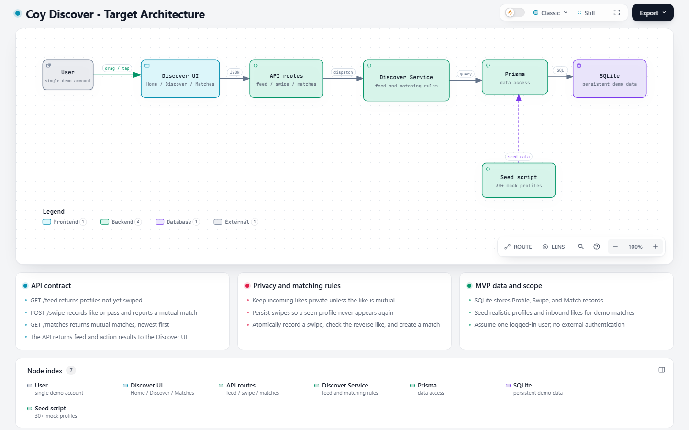

# Coy Discover

A standalone, privacy-first Discover prototype built for the Coy SDE Intern assignment. Explore profiles, like or pass, and see a match only when interest is mutual.

## What’s inside

- **Discover:** animated, draggable profile cards, desktop Like/Pass controls, keyboard arrows, pagination, loading and retry states.
- **Matches:** responsive grid of mutual matches, newest first, with relative match times.
- **Privacy:** feed and match responses use explicit profile fields; one-sided likes and internal flags are not sent to the browser.
- **Backend:** Next.js route handlers, Prisma, SQLite, transactional swipe/match writes, and database uniqueness constraints.
- **Demo data:** 32 sample profiles and seven seeded incoming likes, so mutual matches can be demonstrated immediately.

## Target architecture

The diagram shows the intended system architecture; the database, API, and Discover UI are now implemented.



## Run locally

Requirements: Node.js 20+ and npm.

```powershell
npm install
Copy-Item .env.example .env
npm run db:generate
npm run db:push
npm run db:seed
npm run dev
```

Open [http://localhost:3000](http://localhost:3000). The app opens on Discover. `db:seed` resets the local demo data before inserting the profiles and incoming likes.

## API

| Method | Route | Purpose |
|---|---|---|
| `GET` | `/api/feed?limit=10&offset=0` | Paged profiles the current user has not swiped on |
| `POST` | `/api/swipe` | Records a `LIKE` or `PASS`; returns match details only for a mutual like |
| `GET` | `/api/matches` | Lists mutual matches, newest first |
| `GET` | `/api/me` | Returns the current demo profile for the match celebration |

Example swipe body:

```json
{ "profileId": 2, "action": "LIKE" }
```

## Rate limiting

The swipe route uses an in-memory limit of 30 requests per minute per IP. It works for a reviewer running the repository locally and needs no Redis configuration. In-memory limits reset when the server restarts and are not shared across multiple Vercel/serverless instances; use a shared store such as Redis/Upstash for consistent production rate limiting.

## Product suggestions (Part A)

1. **Vibe Check:** let both people answer a short set of light compatibility prompts. Reveal shared answers only after both opt in, without exposing who initiated the connection.
2. **Mutual Connections Hint:** show an anonymous count of shared Coy connections without revealing identities. This can help people feel more comfortable while preserving privacy.

## Technology

Next.js App Router, React, TypeScript, Tailwind CSS, Framer Motion, Prisma, and SQLite. Demo profile photos are loaded from Random User; the UI falls back to initials if a photo cannot load.
